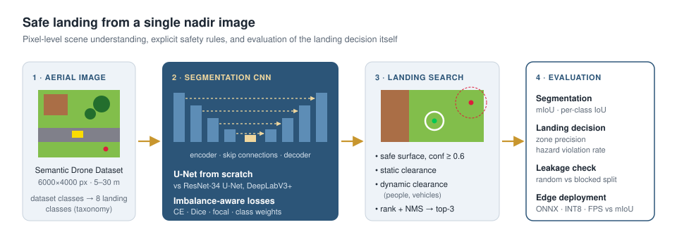

# Safe Landing-Zone Detection for UAVs

Semantic segmentation of downward-looking drone images and a rule-based search for safe landing spots, evaluated on whether the chosen spots are actually safe and not only on pixel accuracy.

## Motivation

A drone that has to land outside a prepared site (after a link loss, on low battery, or for a delivery) needs to understand the ground below it. The difficult classes are the small ones: a person or a bicycle covers well under 1% of the image, but they matter most for safety. A good mean IoU also does not tell you directly whether a selected landing spot is safe, so the landing decision is evaluated separately.

## Approach

- Segmentation networks: a U-Net implemented from scratch (about 7.8 M parameters), compared with U-Net and DeepLabV3+ using ImageNet-pretrained ResNet encoders.
- The 20 classes of the Semantic Drone Dataset are mapped to 8 classes that matter for landing: safe surfaces, static hazards (buildings, trees, water, obstacles) and dynamic hazards (people, vehicles).
- Class imbalance: cross-entropy, Dice and focal loss, and class weighting.
- Landing-zone search on the predicted probabilities: the footprint must lie on a confidently predicted safe surface, keep a margin from static hazards and a larger margin from people and vehicles. Sizes can be given in metres using flight altitude and camera parameters.
- Landing metrics: share of proposed zones that are safe in the ground truth, share with a hazard inside the footprint, and how often a safe zone is found when one exists.
- Overlapping frames: the test set is a fixed set of contiguous image blocks, and a random validation split is compared with a blocked one to see how much neighbouring frames inflate the scores.
- Deployment: ONNX export and INT8 quantisation, with speed and accuracy reported together.

The full experiment design is in [docs/DESIGN.md](docs/DESIGN.md).

## Progress

- [x] U-Net implemented from scratch and pretrained-encoder baselines
- [x] Landing taxonomy for the Semantic Drone Dataset
- [x] Dice, focal and weighted losses
- [x] Landing-zone search with static and dynamic clearances
- [x] Landing metrics against the ground truth
- [x] Random vs blocked validation split
- [x] ONNX export and INT8 benchmark
- [x] Unit tests, end-to-end test and Colab notebook

Next:

- [ ] Model and loss comparison on the Semantic Drone Dataset
- [ ] Deployment benchmark on CPU

## Code

The implementation (models, training, landing-zone search, export scripts, tests and a Colab notebook) is kept in a private repository for now. I am happy to share it on request.

## Data

[Semantic Drone Dataset](https://ivc.tugraz.at/research-project/semantic-drone-dataset/), Institute of Computer Graphics and Vision, Graz University of Technology (non-commercial use). The data is not redistributed here.

## References

- O. Ronneberger, P. Fischer, T. Brox. U-Net: Convolutional Networks for Biomedical Image Segmentation. MICCAI, 2015.
- L.-C. Chen et al. Encoder-Decoder with Atrous Separable Convolution for Semantic Image Segmentation. ECCV, 2018.
- T.-Y. Lin et al. Focal Loss for Dense Object Detection. ICCV, 2017.
